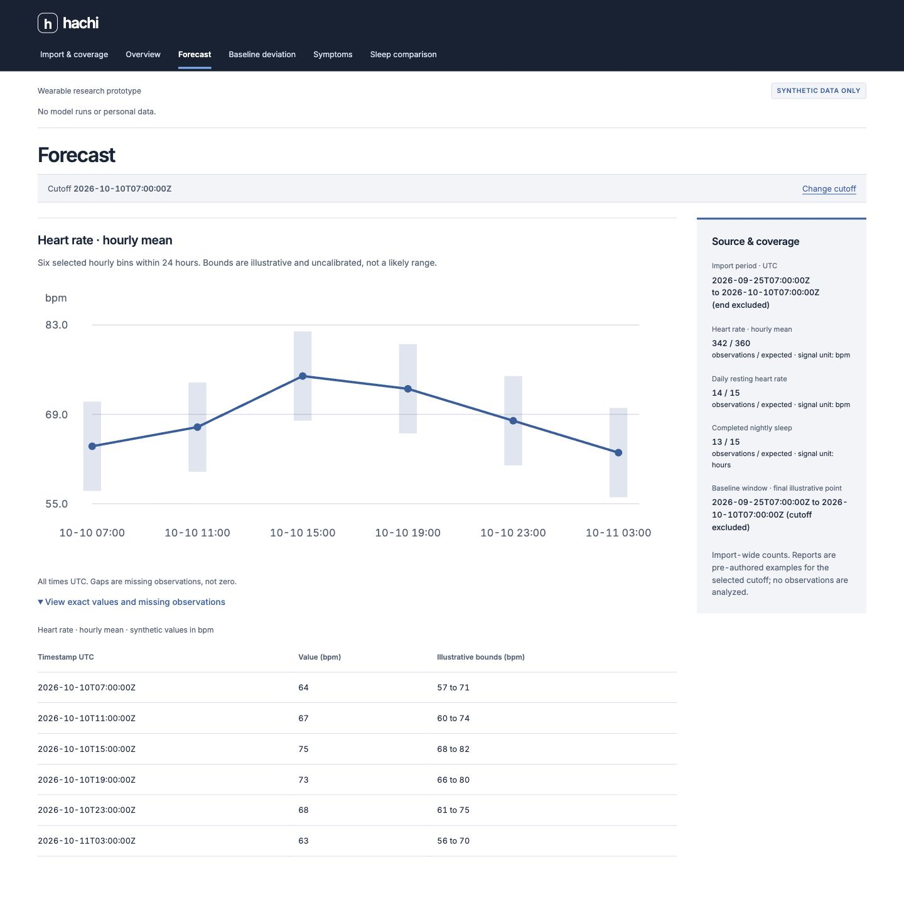

# Hachi

**Your wearable records your past. Hachi helps you look ahead.**

Hachi is a local wearable-health research prototype built for our hackathon. It turns physiological history into forecasts, shows changes from a personal baseline, and lets you explore how different sleep schedules might affect alertness.

The idea started when our teammate George got sick just before the hackathon. We already wear devices that record heart rate, sleep, and activity. Could that history help us prepare for the next few days, instead of only reviewing the last few?

Our long-term goal is to give people useful advance warning about changes in how they may feel. The current project combines a working web interface, local inference on an ASUS GX10 with NVIDIA GB10, and reproducible research evaluations. Illness and recovery prediction remain research work with separate validation requirements.

[Demo and presentation](docs/DEMO.md) · [Research](docs/RESEARCH.md) · [Evaluation evidence](docs/presentation/CLAIMS.md) · [Development](docs/DEVELOPMENT.md)



*Forecast interface from the earlier synthetic UI walkthrough. These values and bounds are illustrations, not participant data or measured model results. The integrated app now consumes API responses; see the [app rehearsal evidence](reports/verification/app-rehearsal/README.md).*

## What Hachi does

- **Import wearable history.** Read Apple Health XML or ZIP exports and inspect available signals, coverage, gaps, and time zones.
- **Forecast physiology.** Predict the next 24 hourly heart-rate bins when a compatible model artifact and enough history are available. Display units, model identity, and uncertainty where supported.
- **Review baseline deviations.** Provide an anomaly-report interface and research evaluation of unusual physiological changes. Missing validated artifacts produce explicit unavailable states.
- **Record symptoms.** Save symptom check-ins with separate event and entry times, corrections, and deletion support.
- **Compare sleep schedules.** Explore two schedules through a conditional sleep-pressure and circadian simulator. Its output is a synthetic, dimensionless simulation; measured personal alertness remains unvalidated.
- **Replay a saved result.** Inspect a previously recorded forecast with its original source and model provenance, even when the live API is offline.

The Apple importer is implemented, but a Fitbit-trained model does not automatically support Apple Watch data. Source transfer requires explicit artifact admission and remains unvalidated until evaluated. Illness probabilities and recovery estimates stay unavailable in the product without accepted task-specific evidence.

## How it works

```text
Wearable export / admitted research dataset
                  |
                  v
Canonical observations + coverage + causal history cutoff
                  |
                  v
Versioned model artifact -> forecast + uncertainty + provenance
                  |
                  v
Local FastAPI service -> React dashboard -> saved-result replay

Sleep schedules + explicit assumptions -> conditional simulator
```

The forecasting system uses numerical time-series models. We compare simple baselines, trained task heads, Chronos-2, pretrained wearable representations, fine-tuning, and ensembles. Model selection considers paired error, interval coverage, missingness, latency, and memory.

Inputs include only observations available by the forecast cutoff. Whole-participant splits and temporal evaluation keep future labels separate from historical inputs. Versioned artifacts connect each result to its code, configuration, dataset snapshot, and evaluation protocol.

The default workflow runs the interface and API on loopback, with GPU jobs coordinated on the team's GX10. Model inference does not require a paid cloud AI provider. If GPU inference runs on the separate GX10, model inputs travel to that machine through the configured private connection; see the [private operation runbook](infra/demo/README.md).

## Results so far

Our development forecasting experiment uses **PMData, a Fitbit research dataset**, to predict next-day hourly mean heart rate. The development-selected model is **Chronos-2 zero-shot with a 720-hour history context**.

| Candidate | Mean absolute error, bpm (95% participant bootstrap interval) | Scored hourly targets |
|---|---:|---:|
| Last-valid-value baseline | 12.03 (10.94–13.01) | 1,599 |
| Seasonal baseline | 11.15 (9.42–12.94) | 1,464 |
| Causal tree baseline | 10.32 (9.38–11.30) | 1,481 |
| Chronos-2, 48-hour context | 8.94 (7.69–10.17) | 1,599 |
| **Chronos-2, 720-hour context** | **8.05 (7.15–9.15)** | **1,599** |

These results cover **12 development-validation participants across three inner folds**. Of 2,016 scheduled target hours, 168 lacked sufficient history and 249 lacked labels. Each table row uses that model's available predictions; improvement comparisons use common paired targets in the [full selection report](reports/models/issue12-pmdata-hourly-selection.md).

The selected model's nominal 80% intervals covered 78.2% of observed targets, with a mean width of 23.02 bpm. Native intervals remain uncalibrated after selection. Actual Chronos-2 fine-tuning and stacked ensembles were evaluated, but neither passed the promotion rule over the longer-context zero-shot model.

**These are development results.** Multiple candidates were compared on the same small cohort, so selection may be optimistic. Four outer-test participants remain sealed. Heart-rate forecast error does not establish illness accuracy, Apple Watch transfer, or clinical validation.

Separate illness-onset experiments use labeled retrospective data. Their current survey-selection and calibration limitations prevent a general claim about when someone will get sick. Recovery requires accepted censoring-aware follow-up and baseline comparisons. See the [evidence narrative](docs/presentation/NARRATIVE.md) for results, negative findings, and task-specific limits.

## Run locally

Use **Python 3.12+**, [uv](https://docs.astral.sh/uv/), [Bun](https://bun.sh/), and **Node.js 22.14.0+**.

From the repository root, install the locked environments, regenerate contracts, and run the repository checks:

```sh
make
```

Start the API in one terminal. Choose unused ports and a fresh private workspace outside Git for each instance:

```sh
HACHI_WORKSPACES="$(mktemp -d /tmp/hachi-local.XXXXXX)" \
  uv run --locked --extra api python -I -m hachi.api serve \
  --owner ezzy1630 --port 18718
```

Start the web client in another terminal:

```sh
cd apps/web
npm ci
VITE_HACHI_API_PROXY_TARGET=http://127.0.0.1:18718 \
  npm run dev -- --port 15173 --strictPort
```

Open the loopback URL printed by Vite. This starts the interface and an API with no research snapshots or forecast artifacts configured; unsupported reports display their requirements. The sleep-schedule simulator uses schedules and assumptions without reading subject history. Configuring a validated forecast requires approved data and pinned artifacts through the [API setup](src/hachi/api/README.md).

For GPU setup and queued inference, follow the [GX10 runtime guide](infra/gx10/README.md). For the original real-PMData live/offline walkthrough, use the [rehearsal runbook](scripts/rehearsal/README.md). These evidence paths have their own producing revisions; a fresh complete demonstration of the final selected system remains an open gate in [the demo guide](docs/DEMO.md).

The web client has a separate production-build check. From the repository root:

```sh
cd apps/web
npm run build
```

## Repository map

```text
apps/web/                React, TypeScript, and Vite interface
src/hachi/data/           dataset admission, Apple Health and research-data ingestion
src/hachi/models/         baselines, pretrained adapters, task heads, and selection
src/hachi/evaluation/     causal splits, replay, metrics, and finalization
src/hachi/api/            FastAPI import, reports, check-ins, and scenarios
src/hachi/storage/        local SQLite metadata and private paths
src/hachi/scenarios/      conditional sleep/alertness simulation
src/hachi/contracts/     authoritative Python contract models
contracts/               generated JSON Schema, TypeScript types, and fixtures
configs/                 source, feature, evaluation, and experiment definitions
infra/gx10/              pinned GPU runtime and setup
scripts/                 GPU coordination, evaluation, privacy, and rehearsal tools
reports/                 aggregate research results and verification receipts
docs/                    product scope, research, coordination, and presentation
```

## Data and privacy

Raw health exports, participant-level tables and predictions, credentials, model checkpoints, and private run artifacts stay outside Git. Dataset access and storage follow each source's recorded terms. Public screenshots use synthetic data; research reports contain aggregate results.

The local API is a trusted single-operator service. A shared GX10 account does not provide participant privacy isolation. Personal-case processing and public display require separate consent, and a retrospective one-person case cannot establish population accuracy.

Hachi is a research prototype. Its forecasts are not diagnoses or treatment guidance.

## Team and contributing

Built by **Ezzy, Justin, and George** for the hackathon.

| Development lane | Initial owner |
|---|---|
| Models and evaluation | [@ezzy1630](https://github.com/ezzy1630) |
| Data and backend | [@justin06lee](https://github.com/justin06lee) |
| Product and demo | [@CoffeeCoder1015](https://github.com/CoffeeCoder1015) |

Read [coordination and issue ownership](docs/COORDINATION.md) before starting assigned work. Use separate worktrees and runtime state, preserve the [shared contracts](docs/CONTRACTS.md), and attach reproducible evidence to changes. The [roadmap](docs/ROADMAP.md) and [product completion gates](docs/PRODUCT.md#completion-gates) define the remaining work.
