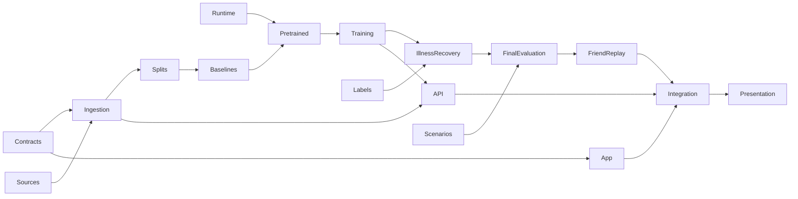

# Team roadmap

The live work queue is [GitHub Issues](https://github.com/vibemonkies/hachi/issues); the [delivery tracker](https://github.com/vibemonkies/hachi/issues/26) collects all gates. No deadline assumptions or due dates are imposed.

## Start in parallel

Read the [per-person parallel groups and Git workflow](COORDINATION.md). Issue numbers are global, not a sequence each teammate repeats. The initial independent set is **#1 + #2 + #3 + #4**, split across their existing owners. Check active claims before starting another agent.

| Person | Start now | Next responsibility |
|---|---|---|
| @ezzy1630 | #1: isolated GX10 runtime and GPU coordination | Evaluation harness, baselines, pretrained models, training and calibration |
| @justin06lee | #2 and #3 simultaneously: dataset admission/access and executable contracts | Real ingestion, labels, API and private storage |
| @CoffeeCoder1015 | #4: app shell and interaction flows | Alertness scenarios, dashboard/check-ins, integration and presentation |

This is an initial division, not a skill ranking. Change assignees explicitly when the team agrees to swap. Shared schemas and root lockfiles have one coordinating owner. Separate remote checkouts, environments and databases prevent collisions; see [development workflow](DEVELOPMENT.md).

## Milestones

- **M0 — Shared foundation:** contracts, runtime, source admission and initial UX.
- **M1 — Usable data and evaluation:** canonical features, Apple importer, grouped splits and real outcome labels.
- **M2 — Trained models:** baselines, pretrained candidates, trained/adapted heads, illness, recovery and alertness.
- **M3 — Working product:** backend, real charts, check-ins/scenarios and private operation.
- **M4 — Verified demo:** final evaluation, late friend case, end-to-end rehearsal and presentation.
- **M5 — Research extensions:** broader modality tasks and prospective validation; optional follow-up, not a hidden demo dependency.

Milestones group outcomes rather than imposing a waterfall. The UI works against labeled fixtures immediately; backend contracts can develop before final artifacts. Dependencies below indicate evidence/integration gates. The Apple parser can be built with synthetic inputs in M1; acquiring and validating the friend's real export stays in the late case-study issue #21. Never silently close a required capability because its dataset is unavailable.

## Work queue

| Issue | Deliverable | Owner | Milestone | Depends on |
|---|---|---|---|---|
| [#1](https://github.com/vibemonkies/hachi/issues/1) | Prove an isolated GX10 runtime and coordinate GPU jobs | @ezzy1630 | M0 | Ready now |
| [#2](https://github.com/vibemonkies/hachi/issues/2) | Admit datasets with verified access, terms and task compatibility | @justin06lee | M0 | Ready now |
| [#3](https://github.com/vibemonkies/hachi/issues/3) | Implement canonical contracts, synthetic fixtures and repository checks | @justin06lee | M0 | Ready now |
| [#4](https://github.com/vibemonkies/hachi/issues/4) | Build the app shell and interaction flows against labeled fixtures | @CoffeeCoder1015 | M0 | Ready now |
| [#5](https://github.com/vibemonkies/hachi/issues/5) | Acquire PMData and produce reproducible canonical features | @justin06lee | M1 | [#2](https://github.com/vibemonkies/hachi/issues/2) [#3](https://github.com/vibemonkies/hachi/issues/3) |
| [#6](https://github.com/vibemonkies/hachi/issues/6) | Build the streaming Apple Health importer and coverage audit | @justin06lee | M1 | [#3](https://github.com/vibemonkies/hachi/issues/3) |
| [#7](https://github.com/vibemonkies/hachi/issues/7) | Build participant splits and causal rolling-origin evaluation | @ezzy1630 | M1 | [#3](https://github.com/vibemonkies/hachi/issues/3) [#5](https://github.com/vibemonkies/hachi/issues/5) |
| [#8](https://github.com/vibemonkies/hachi/issues/8) | Acquire labeled illness/recovery cohorts and lock outcome definitions | @justin06lee | M1 | [#2](https://github.com/vibemonkies/hachi/issues/2) [#3](https://github.com/vibemonkies/hachi/issues/3) |
| [#9](https://github.com/vibemonkies/hachi/issues/9) | Implement honest physiology and anomaly baselines | @ezzy1630 | M2 | [#7](https://github.com/vibemonkies/hachi/issues/7) |
| [#10](https://github.com/vibemonkies/hachi/issues/10) | Benchmark Chronos-2 on real wearable forecasts | @ezzy1630 | M2 | [#1](https://github.com/vibemonkies/hachi/issues/1) [#7](https://github.com/vibemonkies/hachi/issues/7) [#9](https://github.com/vibemonkies/hachi/issues/9) |
| [#11](https://github.com/vibemonkies/hachi/issues/11) | Evaluate wearable representations with OpenMHC and a compatible comparator | @ezzy1630 | M2 | [#1](https://github.com/vibemonkies/hachi/issues/1) [#7](https://github.com/vibemonkies/hachi/issues/7) [#9](https://github.com/vibemonkies/hachi/issues/9) |
| [#12](https://github.com/vibemonkies/hachi/issues/12) | Train adapted task models and select an evidence-backed ensemble | @ezzy1630 | M2 | [#10](https://github.com/vibemonkies/hachi/issues/10) [#11](https://github.com/vibemonkies/hachi/issues/11) |
| [#13](https://github.com/vibemonkies/hachi/issues/13) | Train and calibrate short-horizon illness-onset predictions | @ezzy1630 | M2 | [#8](https://github.com/vibemonkies/hachi/issues/8) [#9](https://github.com/vibemonkies/hachi/issues/9) [#12](https://github.com/vibemonkies/hachi/issues/12) |
| [#14](https://github.com/vibemonkies/hachi/issues/14) | Train a censoring-aware recovery model | @ezzy1630 | M2 | [#8](https://github.com/vibemonkies/hachi/issues/8) [#7](https://github.com/vibemonkies/hachi/issues/7) |
| [#15](https://github.com/vibemonkies/hachi/issues/15) | Implement and evaluate conditional sleep/alertness scenarios | @CoffeeCoder1015 | M2 | [#3](https://github.com/vibemonkies/hachi/issues/3) [#5](https://github.com/vibemonkies/hachi/issues/5) |
| [#16](https://github.com/vibemonkies/hachi/issues/16) | Implement the import/report API and versioned artifact loading | @justin06lee | M3 | [#3](https://github.com/vibemonkies/hachi/issues/3) [#5](https://github.com/vibemonkies/hachi/issues/5) [#6](https://github.com/vibemonkies/hachi/issues/6) [#9](https://github.com/vibemonkies/hachi/issues/9) |
| [#17](https://github.com/vibemonkies/hachi/issues/17) | Connect the dashboard to real forecast and anomaly responses | @CoffeeCoder1015 | M3 | [#3](https://github.com/vibemonkies/hachi/issues/3) [#4](https://github.com/vibemonkies/hachi/issues/4) [#16](https://github.com/vibemonkies/hachi/issues/16) |
| [#18](https://github.com/vibemonkies/hachi/issues/18) | Connect symptom check-ins, recovery and sleep comparisons | @CoffeeCoder1015 | M3 | [#15](https://github.com/vibemonkies/hachi/issues/15) [#16](https://github.com/vibemonkies/hachi/issues/16) [#17](https://github.com/vibemonkies/hachi/issues/17) |
| [#19](https://github.com/vibemonkies/hachi/issues/19) | Verify private storage, deletion and safe demo operation | @justin06lee | M3 | [#6](https://github.com/vibemonkies/hachi/issues/6) [#16](https://github.com/vibemonkies/hachi/issues/16) |
| [#20](https://github.com/vibemonkies/hachi/issues/20) | Freeze final model selection and publish the aggregate evaluation packet | @ezzy1630 | M4 | [#12](https://github.com/vibemonkies/hachi/issues/12) [#13](https://github.com/vibemonkies/hachi/issues/13) [#14](https://github.com/vibemonkies/hachi/issues/14) [#15](https://github.com/vibemonkies/hachi/issues/15) |
| [#21](https://github.com/vibemonkies/hachi/issues/21) | Run the late held-out Apple Watch illness case study | @CoffeeCoder1015 | M4 | [#6](https://github.com/vibemonkies/hachi/issues/6) [#9](https://github.com/vibemonkies/hachi/issues/9) [#20](https://github.com/vibemonkies/hachi/issues/20) |
| [#22](https://github.com/vibemonkies/hachi/issues/22) | Rehearse the complete app with actual model artifacts | @CoffeeCoder1015 | M4 | [#16](https://github.com/vibemonkies/hachi/issues/16) [#17](https://github.com/vibemonkies/hachi/issues/17) [#18](https://github.com/vibemonkies/hachi/issues/18) [#19](https://github.com/vibemonkies/hachi/issues/19) [#20](https://github.com/vibemonkies/hachi/issues/20) [#21](https://github.com/vibemonkies/hachi/issues/21) |
| [#23](https://github.com/vibemonkies/hachi/issues/23) | Prepare the evidence-backed demo and presentation | @CoffeeCoder1015 | M4 | [#22](https://github.com/vibemonkies/hachi/issues/22) |
| [#24](https://github.com/vibemonkies/hachi/issues/24) | Evaluate additional datasets and waveform model branches | @justin06lee | M5 | [#2](https://github.com/vibemonkies/hachi/issues/2) [#7](https://github.com/vibemonkies/hachi/issues/7) |
| [#25](https://github.com/vibemonkies/hachi/issues/25) | Establish prospective prediction logging and independent validation | @ezzy1630 | M5 | [#20](https://github.com/vibemonkies/hachi/issues/20) [#22](https://github.com/vibemonkies/hachi/issues/22) |

Each issue specifies file ownership, acceptance criteria and a reproducible handoff. Status labels require manual updates when dependencies land. The tracker checklist is also manual; synchronize it during team integration reviews.

## Critical dependencies

## Definition of done

The initial scope is complete when required issues pass their own evidence gates and the final tracker is verified by the team. The repository setup itself does not establish that any predictive model works. Read [completion gates](PRODUCT.md#completion-gates) and [evaluation protocol](EVALUATION.md) before interpreting a closed issue as a scientific result.
