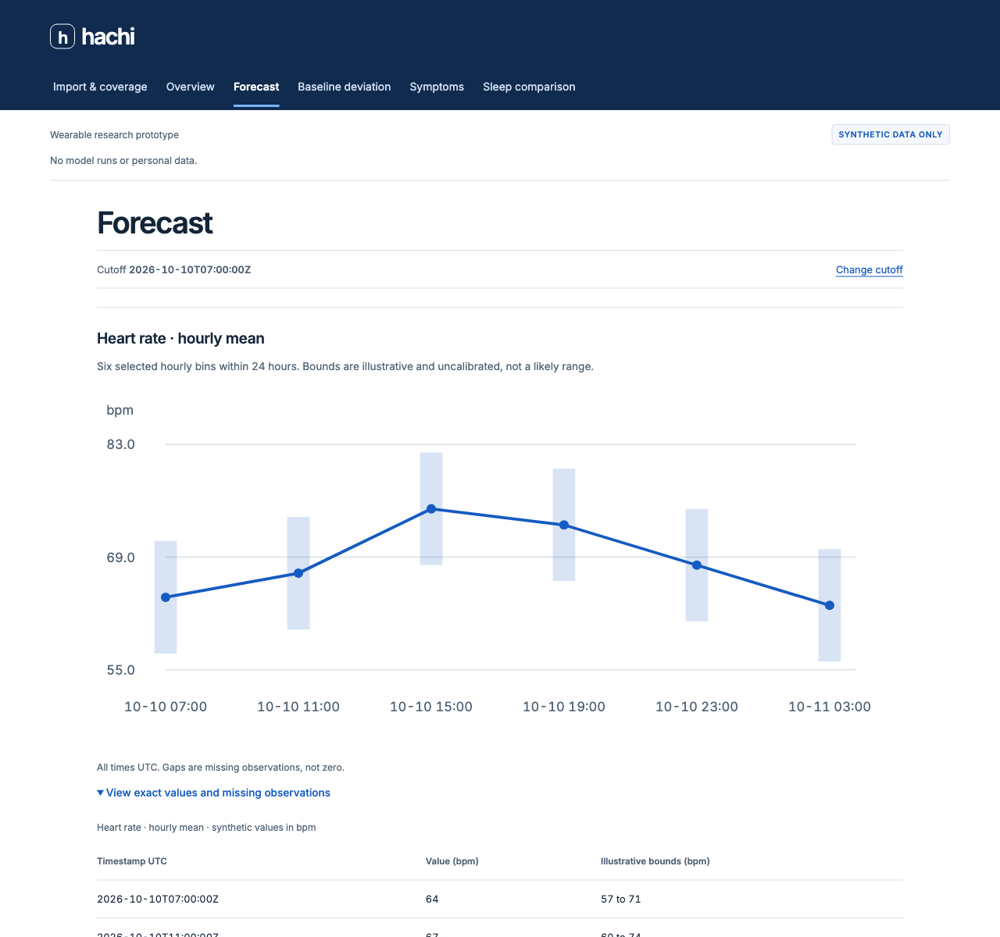
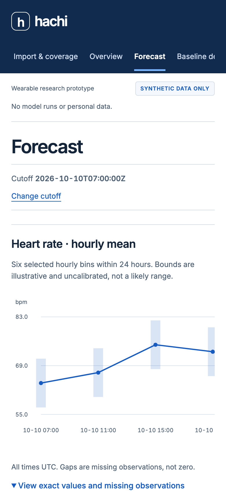

# App rehearsal groundwork — #22 stays incomplete

JadeOx, representing `ezzy1630` on `MacBook-Air-4.local`, owns this rehearsal lane
in the T3-bound `issue-22-ezzy-parallel-rehearsal` worktree. The accountable #22
assignee remains CoffeeCoder1015. Parent SnowyFortress confirmed the delegated
tooling scope through hachi-mail. Work chat:
`t3-thread://v1/mcp:7a352bae-fe61-4baf-8d94-fdc8ae1db703`.

The real baseline **backend** and independent private replay consumer paths passed.
The product's real import → report → chart and app replay remain unverified. No final model is
selected, no outer test was opened, and no clinical/product gate is waived.

## Private replay consumer follow-up

[PR86](https://github.com/vibemonkies/hachi/pull/86) merged at `91bc669` from
CI-passing head `825799f`. It delivers the standalone private replay consumer;
the source-bound receipts below do not prove Coffee's app integration.

The corrected current-source receipts are [API](api-e76626b.json),
[replay](replay-e76626b.json) and [browser](replay-browser-e76626b.json), produced
at clean `e76626b` after main through #72/#80/#84/#85. The real API again matched
25 origins/600 points against packet and direct inference. With the live API
stopped, the real viewer matched all 24 medians, all 48 visible interval endpoints,
the exact visible cutoff and elapsed UTC geometry, with zero discrepancies.
No real timestamp/row/prediction was emitted in browser tool output or captured.
The saved response is unchanged except `ReplayInfo`; its original mode and source
provenance remain intact.

The valid generated staggered-window replay matched five points and ten visible
endpoints, retaining three missing target windows and the unavailable HRV reason.
The [synthetic desktop](replay-utc-synthetic-desktop.png),
[mobile cutoff](replay-utc-synthetic-phone-cutoff.png),
[mobile intervals](replay-utc-synthetic-phone-intervals.png),
[mobile bounds after local horizontal scroll](replay-utc-synthetic-phone-bounds.png)
and [missing-cache error](replay-utc-synthetic-missing-cache.png) are bound by exact
SHA256 and capture metadata in the browser receipt. Mobile body width is 390;
only the focusable tables scroll horizontally. All screenshots contain generated
synthetic content or an empty error, and belong to this corrected source.

Local `make check`, with api/baselines extras installed, passed 687 tests, six
subtests, five coordination checks and generated-contract checks. All 19 focused
runtime/replay tests pass. Owned services and tabs were stopped. Full app/#22
integration remains gated; this is the standalone replay consumer.

The parent review of `e33ed3e` found a rendered fidelity blocker: the original
viewer omitted `as_of` and interval endpoints, and its chart x coordinate was an
ordinal index. Earlier browser receipts verified numeric points, recorded/generated
metadata and that ordinal geometry; they **did not verify forecast target times**.
Their dates and hashes remain historical evidence, not UTC target fidelity proof.
The scoped correction shows canonical UTC cutoff/intervals, uses interval midpoints
on one elapsed UTC domain across series, leaves initial/inter-series/trailing target
gaps blank, and displays unavailable metric reasons. The new comparison checks
visible cutoff, every interval endpoint and independent elapsed UTC geometry.

Generated gap coverage uses valid contiguous series with staggered target windows:
HR hours 1–4, steps hours 10–12, on the request's common 24-hour domain. The
initial hour, six-hour separation and final twelve hours remain blank. The shared
contract forbids noncontiguous points within one series; it was not bypassed.
A focused regression failed before the correction on the missing cutoff, then
passed. Host refusal and non-GET tests exercise real loopback HTTP. Five focused
runtime guard tests now cover sealed test/validation-only origins, exact source
coverage, forbidden interval claims/warnings and abstention only with empty
packet **and** direct references. The original 12-test suite is now 19 tests.

GreenBison's independent review had no blocking findings at `e33ed3e`. Its base CI
count was 524 passed / 12 skipped / three subtests; api/baselines extra stages ran
separately. The local totals below include those extras and should not be read as
base-CI totals. Screenshots are now bound by SHA256/capture metadata in their
producing browser receipt.

After integrating main through PR75/78/81, `d947f55` repeated the actual runtime
and rendered replay, rather than relying on the earlier receipts. Current
[API](api-d947f55.json), [replay](replay-d947f55.json) and
[browser aggregate](replay-browser-d947f55.json) receipts again show 25 origins,
600 exact API points, the whole saved response unchanged except replay metadata,
and 24 exact rendered points/geometry with the live API stopped. The final
`make check`, with api/baselines extras installed, passed 629 tests, three subtests, five coordination tests and all
generated contract checks. Replay viewer source and synthetic screenshots are
unchanged from `d812e94`; the earlier producing-source evidence remains below.

On branch `issue-22-private-replay`, source `849bff2` ran the current API after
PR76/77/79. [API receipt](api-849bff2.json) repeats all 25 origins and 600 points
exactly against both references. It now records the owner and public packet key
with matching evaluation/origin/split digests. The actual launch caught a second
PR76 caller break (`serving_from_protocol` needs the model directory); the owned
caller was fixed before any inference. The failed run root remains private.

The live API was stopped. At consumer `d812e94`, the versioned private cache
projected that actual saved completed response through authoritative contracts.
[Replay receipt](replay-d812e94.json) checks the entire response unchanged except
`ReplayInfo`: 24 forecast points, original `real` mode, original generated time,
code, artifact, snapshot, quality and warning state retained. The separately pinned
cache digest prevents a rehashed substitute from passing. No API request or fresh
inference happens in the replay provider.

[Rendered aggregate receipt](replay-browser-d812e94.json) binds the cache and
`browser_compare.js` hash. T3's actual DOM/SVG/table had 24/24 equal medians and
correct point geometry, unit, quality, timestamps and source provenance. Null
bounds appeared as unavailable, and no interval band/coverage claim appeared.
The page omitted subject/report identifiers. No snapshot or screenshot of the
real chart was taken. Browser observation returned aggregates only; external
resource requests were disallowed by CSP and the live API port had no listener.
This establishes the **dedicated rehearsal viewer**, not Coffee's app path.

Separate synthetic contract-fixture replay passed the same 24-point rendered
comparison. These screenshots are illustrations, not real-data evidence:

- [Synthetic desktop replay](replay-synthetic-desktop.png)
- [Synthetic 390×844 replay](replay-synthetic-phone.png), body width 390 with no overflow
- [Missing private cache error](replay-missing-cache.png), actual HTTP 409,
  `CACHE_MISSING`, visible alert/action and no fallback; no overflow on mobile

Local `make check`, with api/baselines extras installed, passed 580 tests, three subtests, five coordination tests and
generated schema/fixture/TypeScript checks. Twelve focused integrity/replay tests
pass, including original response preservation, tampering after rehash, missing
and corrupt cache, changed schema, public files/symlinks, pending/already replayed
sources, point-only/unavailable/error rendering and actual loopback HTTP behavior.
All owned services/tabs were stopped after capture. Private cache/responses stay
outside Git. Historical receipts below retain the gates that existed at their
producing commits.

Coffee's [#17 response](https://github.com/vibemonkies/hachi/issues/17#issuecomment-6109148723)
says a local review package is being prepared, publication is withheld, and the
replay module/root wiring is not yet agreed. No Coffee code was copied or published.
Full #22 still requires #17/#18/#19/#20/#21 and actual source-specific Apple/API
integration; there is no final-model, held-out-test or friend-case claim.

## What was observed

At clean `a7dcb49a23c996209d29332a4bd427811895443a`, the isolated local API
on 8720 loaded an admitted PMData snapshot and one frozen inner-0 last-valid
comparator. [API receipt](api-a7dcb49.json): 25/25 validation origins returned
`ok`; 600/600 points equaled the saved packet and fresh evaluator inference.
Both comparisons had zero missing/extra points, zero mismatches and max |Δ| 0.
The API result had the actual artifact/snapshot/code identity, `data_mode: real`,
HR in bpm, null bounds and nominal coverage, and `interval_calibration: none`.
Report retry returned the same job. All original private artifacts were preserved.
This earliest receipt predates the public packet-index gate and has no
`published_packet_index_sha256`; the later receipts enforce that gate.

After integrating main through PR65, at clean
`e17f825d636b5902549e7821c21f3a751f4f6dd4`, the stricter check also bound the
packet to its **published** split/origin/evaluation/protocol hashes and checked
quality coverage against source history. [Second receipt](api-e17f825.json)
again records 25 origins and 600 exact points in both comparisons. The private
runtime was `~/hachi/runtime/jadeox/run-002`, with its own staged read-only
artifact, workspace and SQLite database. Mean HTTP job latency was 0.175 s
(0.153–0.218 s), while a separate test process ran concurrently; this is local
rehearsal timing, not a model benchmark or a performance improvement claim.

Final source verification at clean
`4129197028d4c6bf758a4a7d3b6d695ac889d00a` adds exact private subject/cutoff/job
identity checks and disables inherited HTTP proxies for the loopback client.
[Final receipt](api-4129197.json) again has 25/25 origins and 600/600 matching
points against both references, with no missing/extra points. Runtime root
`~/hachi/runtime/jadeox/run-003` and owned session 33677 were stopped afterward.
Mean local job latency was 0.197 s (0.176–0.240 s); no performance comparison is
claimed across these checks.

After main's PR66 privacy changes landed, the affected API/storage path was
integrated and rehearsed again at clean
`88094a3c68118385559d3c9e555685c40a2fab94`.
[Post-privacy receipt](api-88094a3.json): 25/25 origins, 600/600 exact points
against packet and evaluator, zero missing/extra points, point-only results,
and all separate synthetic lifecycle checks passed. API/privacy tests passed
56/56, plus the five rehearsal integrity tests. Owned session 53837 and runtime
`~/hachi/runtime/jadeox/run-004` were stopped after the check. This incorporates
the storage/logging changes; the fixture browser source was unchanged.

Actual unavailable responses were anomaly `NO_ARTIFACT_FOR_TASK`, illness
`NO_VALIDATED_ILLNESS_ARTIFACT`, and recovery `NO_ONGOING_EPISODE` for a request
without a recorded ongoing episode. No zero probabilities or recovery curves
were substituted. Unsupported sleep scenarios returned `NO_ARTIFACT_FOR_TASK`.

Separate **synthetic API** transport checks exercised a one-record invented
Apple XML upload, `insufficient` coverage, one stored negative check-in read back
through `SelfReportHistory`, and malformed XML failing with `MALFORMED_XML`.
Those requests are invented transport checks, not clinical labels or real-source
forecast evidence. No check-in was added to a real participant.

## Rendered browser evidence

The current fixture web app was built at `a7dcb49` with Node 26.3.1/npm 11.16.0
and served from its `dist` on loopback 5180. Served index bytes matched the build;
hash, assets, processes, retained sessions and actions are in
[browser-fixture.json](browser-fixture.json). T3 preview drove the native load,
coverage acknowledgment, latest fixture cutoff, report request, forecast link
and exact-value disclosure. Six SVG medians matched six table values, with zero
differences above 1e-9. Desktop and phone screenshots were visually inspected.
At 390 CSS pixels, page width was 390; the plot and table scrolled locally.

These screenshots contain only clearly disclosed synthetic illustrations. The
fixture chart's six **illustrative** interval lines are unrelated to the real
API's point-only result. The page made no API calls. This does **not** prove that
#17's actual chart omits a band, shows the real artifact, or matches API values.

Keyboard/error/scenario/check-in UI states were not exercised in this narrow
fixture run. The API transport checks do not stand in for those UI checks.

## Reproduce and retain boundaries

Follow [the runnable instructions](../../../scripts/rehearsal/README.md).
The private source run used here is
`/Users/ezzyrappeport/hachi/runs/pmdata-hr-validation-20261011-001`; packet
`outer-0-inner-0/evaluations/hourly-last-valid-v1`, model
`outer-0-inner-0/models/hourly-last-valid-v1-141306001b16e168`, and its
`protocol.json`. The source snapshot is under
`/Users/ezzyrappeport/hachi/data/derived/pmdata-features-1-simula-2020-04-24-06606ac2708b`.
Full snapshot, protocol, artifact and published index hashes are in the receipts.
These are comparator artifacts, not #20's selected product artifact.

Environment and cache belong to `~/hachi/runtime/jadeox/{venv,cache}`. Python
3.12.13 used locked `api` and `baselines` extras; `uv.lock` SHA is in each receipt.
The 38 installed distribution name/version pairs hashed to
`1c2d8bfff95f33a0188050750c873122bdd8452ce3f1a8d7c0dab448d8bdc8ef`.
No GPU, tunnel, production service or external participant transport was used.

Owned API/web sessions and T3 tab were stopped/closed. Ports 8720/5180 had no
listeners afterward. Private roots and saved live responses remain for authorized
reproduction, mode 0700/0600; they are outside Git. Logs/snapshots/Git contain no
real participant rows, predictions, IDs, weights or credentials.

Checks: five focused evidence-integrity tests passed; Ruff check/format and
`git diff --check` passed. After integrating main, API/evaluation/baseline tests
passed **152/152** in 18.10 s. Web `npm ci` and `npm run build` passed.
Full local `make check`, using the owned locked `api`/`baselines` environment
without resync and read-only Bun 1.4.0, passed 496 pytest tests, five coordination
tests, schema/fixture regeneration checks and generated TypeScript checks.

PR69's initial default CI environment failed three newly merged #12 numerical
tests because NumPy was not installed (441 passed, three skipped). Those source
files are outside this lane and pass locally with the declared extras. The
shared dependency/CI owner was notified with the
[failed run](https://github.com/vibemonkies/hachi/actions/runs/38137946270).
The upstream fix, PR68 (`9e6f651`), was integrated at a clean checkpoint. Base
checks skip those optional numerical tests when their dependencies are absent;
the existing CI `--extra baselines pytest tests/models` stage runs them with
NumPy/SciPy installed. Runtime source is unchanged by that test-only integration,
so the pre-privacy real-data receipt remains bound to `4129197`. The later
post-privacy receipt is `api-88094a3.json` as described above. Do not merge until
fresh CI and the independent tooling review pass.
The original PR head `d2a49fe` passed all CI stages, including baselines and API
extras, in run `38138236148`. The post-privacy head needs its own fresh CI result
and independent review before merge.

## Outstanding acceptance gates

- #17's owner must publish the actual UI implementation so this lane can run its
  real report/chart path and privately compare displayed values, artifact, units,
  mode and quality with the API. Its checkpoint is currently unpublished.
  Coffee's [confirmed local checkpoint](https://github.com/vibemonkies/hachi/issues/17#issuecomment-6108831979)
  is `659415b`; his authorization reserves CI-triggering publication. That older
  reported checkpoint proxies to 8717 with no API-base setting and has no
  existing-PMData-subject entry seam. Its code and any later local changes remain
  unavailable here; these are reported constraints, not a fresh source review.
  A local proxy override would not by itself create a supported import path.
- Apple input is admitted **per artifact**. This rehearsal's frozen PMData
  comparator has no Apple admission and returns `unavailable` /
  `NO_ARTIFACT_FOR_TASK` for that source. PR85/91 support an explicit serving
  admission with `apple-hour-end-sealed-native-v1`, the model's unchanged metric,
  aggregation and density gates, and an unvalidated-transfer rationale.
  Successful Apple forecasts carry `DEVICE_SHIFT`; sparse history can abstain
  with `INSUFFICIENT_HISTORY`. PR87 excludes real personal Apple imports from
  shared-GPU models pending an approved transfer/retention design.
  [PR90's generated HTTP proof](../../../src/hachi/data/apple_health/README.md#generated-http-transport-against-the-original-frozen-cpu-artifact)
  staged the original `hourly-last-valid-v1-141306001b16e168` artifact with an
  explicit Apple profile, retaining its 0.5/30 HR gates and original receipt
  `e7666ef0f4665006822f9ee9c0988a6de0df1633175ff217a27666ce6f66fa3b`:
  dense generated input matched 24/24 direct points per report;
  sparse input abstained. Successful responses were `synthetic`, point-only and
  carried the unvalidated-transfer `DEVICE_SHIFT` warning. This is generated CPU transport
  evidence, not actual Apple source validation, compatibility for every artifact,
  or real import → app chart evidence. The permitted actual source/app path is
  still required; an admitted PMData report alone does not satisfy it.
  [PR97's thinned-PMData validation](../../models/apple-density-pmdata-hourly-validation.md)
  evaluates a separate predeclared density variant; it is not real-Apple
  validation, artifact selection or an admission change to this pinned rehearsal.
- #18's real check-in/scenario UI and later validated episode/scenario models
  still need their own integration evidence. #19's storage/demo gates, #20's
  final selected artifact/calibration and #21's separately consented held-out
  case remain prerequisites. No friend case, export or consent was created.
- Standalone offline replay is delivered by PR86 and privately rendered with
  the live API stopped: [the current receipt](replay-browser-e76626b.json) verifies
  24 points, all 48 interval endpoints, cutoff, elapsed UTC geometry and source
  provenance. Original `real`/`synthetic` mode is retained; `ReplayInfo`, recorded
  and generated timestamps are visible. No point-only band is invented.
  **Replay through the actual app remains unverified** and must preserve those
  same values, times, units, artifact/snapshot/code, quality, warnings and replay
  provenance with the live API stopped, including visible failure boundaries.
- Network/job failures, full responsive/keyboard accessibility and all required
  real product states remain part of the final integrated rehearsal.

Keep #22 and the reopened [#26 full-delivery tracker](https://github.com/vibemonkies/hachi/issues/26)
open until their acceptance evidence is delivered. PR69/86 deliver runnable
backend/replay groundwork; they do not close the full app end-to-end gates.
